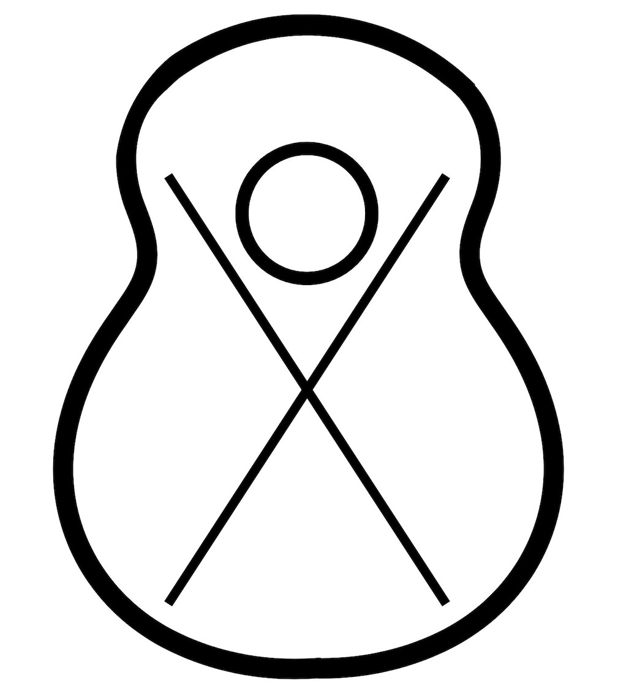

<p align="center"></p>

# Bracing Studio

The touchstone for this project was a simple question: if I know what I want a guitar top to do, can I work backwards to the bracing that gets it there? Traditionally, bracing is designed forwards. You pick a pattern (an X-brace, a fan, whatever your favorite builder used), glue it in, tap the top, and find out what you got. Bracing Studio flips that around. You describe the soundboard (its outline, its wood, the bridge and the string load), tell it which frequencies you want the top to ring at, and it searches for a bracing pattern that hits those frequencies without letting the bridge sink more than a set limit under the strings.

It comes in two flavors that share the exact same interface and physics:

1. **The browser app**, which runs entirely in your browser tab at **[lucalo44.github.io/Modal-Guitar-Bracing-Tool](https://lucalo44.github.io/Modal-Guitar-Bracing-Tool/)**. There's nothing to install, and nothing ever leaves your computer.
2. **The desktop app**, which wraps the same interface in a native window and runs the physics as real Python on your machine. It's faster, runs every bracing pattern in parallel, and adds STEP export for CAD and FEA.

## How it came together

This tool started life as two separate programs, which still live in [legacy/](legacy/): a designer for setting up targets, and a visualizer for drawing braces and seeing what they did. Keeping two tools in sync quickly became more trouble than it was worth, so I merged them into one, which is where the "Design & Draw, One Tool" tagline comes from. With this set, a design that comes out of the search and a design drawn by hand are literally the same object, solved by the same engine, so you can pass designs back and forth between the two freely.

In order to keep the browser version install-free, the whole thing lives in a single file, [index.html](index.html): the HTML and CSS, the JavaScript interface, a Three.js 3D viewer, and the entire Python physics engine, which runs in the page through [Pyodide](https://pyodide.org/) (Python compiled to WebAssembly). This was wonderfully convenient right up until it wasn't. Pyodide runs on the page's single main thread, so every pattern in a "Generate & compare" run had to solve one after another, even though none of them depend on each other. Early on, the search also only handed control back to the browser on progress updates, which meant the entire page froze while it ran. This was not a major success. The fix for the freezing was to yield back to the browser on every single iteration, but the one-thread ceiling is structural, and no amount of clever yielding gets around it.

That ceiling is what led to the desktop build in [desktop/](desktop/). Rather than rewrite anything, I kept the interface as a near-identical copy in [desktop/ui/index.html](desktop/ui/index.html), pulled the Python out into [desktop/engine.py](desktop/engine.py), and wrote a small host in [desktop/app.py](desktop/app.py) that shows the interface in a native window via [pywebview](https://pywebview.flowrl.com/). Specifically, `run_all_patterns_parallel` in the engine gives each bracing pattern its own CPU process. On a 10-core machine, a four-pattern run at 400 iterations each went from 14.9 seconds to 5.5 seconds, about 2.7× faster. After doing so, I added STEP export in [desktop/cad_export.py](desktop/cad_export.py), which turns a solved design into real solid bodies so it can go straight into a CAD or ANSYS model.

Of note, a fair number of the fixes along the way came from the plate shape itself. The fixed-topology presets (X-brace, fan, falcate) used to run right off the edge of the traced body, because the only thing keeping them inside was a soft penalty in the search, and the search never actually moves a fixed brace. I now clip them exactly to the outline instead. Similarly, Novel's mirror line was hard-coded to the center of the drawing window, which looked fine on a perfectly centered body and decidedly less fine on a lopsided hand-trace. It now uses the traced outline's actual area-weighted centroid.

The most recent change came from checking the solver against ANSYS. To do so, I exported an Experimental design as a STEP file, gave the top a fixed support around its edge, and ran a modal analysis. Eight of the first nine modes landed within 3% of the tool. The third did not: 406Hz in the tool against 359Hz in ANSYS, a stubborn 13% gap. The likely culprit was the plate theory. The solver treated the top as a thin (Kirchhoff) plate, which assumes the wood is infinitely stiff in shear through its thickness. Spruce's rolling shear modulus is about 0.04GPa. That assumption overstates the stiffness of short cross-grain bends, which are exactly the bends that live between closely spaced braces.

My first fix split the deflection into a bending part and a shear part. It was cheap, but it fell short. At a 100 × 40mm wavelength, real shear lowers the frequency by 21%, and the split only found 14% of it. The reason is that spruce's two through-thickness shear moduli differ by about 15×, and the split can't represent the shear patterns that difference creates. In order to get all of it, the top is now a full Reissner-Mindlin plate, with the shear strain stored on the links between grid nodes. That roughly tripled the size of the system the solver has to factor. Switching to a symmetric factorization, and reusing one factorization for both the mode solve and the deflection solve, brought a full search back to about 2× its old time.

The next ANSYS run had every mode 5–15% above the tool, which was the opposite direction from before. Part of that was my own setup. The bridge body had picked up the spruce brace material, so ANSYS weighed it at 13.7g instead of 33.2g, an entirely self-inflicted 19g. With 850kg/m³ hardwood on the bridge, the gap shrank to 3–11%, still with ANSYS high. To find the rest, I rebuilt the design from its exported simulation file and re-solved it on finer and finer grids. Every mode rose, by 2–7% between GN 60 and GN 160, which is about the size of the remaining gap. In other words, the search had been tuning designs on a grid that reads a few percent soft. Of note, an X-brace I tested went the other way, falling 2–6% over the same range, so no single factor fits every design.

In order to fix this without making the polish 10–50× slower, the polish now measures a convergence factor for each target on the coarse winner, aims at shifted targets on its own grid, and hands the card a re-solve on the fine grid. My first version paired modes between the two grids by strength. When two weak modes swapped places, it compared a 477Hz mode against a 615Hz one. Following each mode by its shape fixed that. Whether the corrected cards land within a percent or two of ANSYS is the next run I have queued up.

## Using the browser app

Open the [live site](https://lucalo44.github.io/Modal-Guitar-Bracing-Tool/) in a recent Chrome, Edge, or Firefox. The first load downloads numpy and scipy for Pyodide, so the badge in the top-right reads "Loading physics engine…" for anywhere from a few seconds to about a minute. Once it says "Engine ready," you're good to go. (If it hangs much longer than that, an ad-blocker blocking pyscript.net or the CDN is the usual culprit.) You can also just open `index.html` locally, although Chrome and Edge block the folder picker on `file://` pages, so use "Select data folder (compatibility mode)" if you need to import measured data that way.

The app walks you through four tabs, from left to right:

1. **Setup.** Pick a preset outline (Dreadnought or OM/000) or choose Custom and trace your own. In order to trace, upload a photo or scan of a top, scale it with the slider, and click around the edge with the ● Outline tool; ○ Sound hole and ▱ Bridge work the same way. Then set:
   1. The body length, width, and thickness (the Dreadnought default is 508 × 394 mm at 2.8 mm thick).
   2. The top material. Sitka spruce and western red cedar are built in, or you can enter your own along-grain, across-grain, and shear moduli, including the two through-thickness shear moduli (G_LT and G_RT).
   3. The edge boundary condition (clamped by default, which matches a CAD "fixed support").
   4. The string load (300 N by default), the bridge torque, and the maximum deflection you'll allow at the bridge (2 mm by default).

   Before moving on, click **Compute bare-plate reference**. This solves the unbraced top, and since bracing can push a mode up far more easily than it can pull one down, it shows you which targets are actually reachable.
2. **Targets** (optional). If you have measured tap-test data (`.TRF`/`.TRV` or `.AvR`/`.AvC` files), select the data folder, detect peaks, and turn them into target modes. If you don't, just type frequencies straight into the target table. Each row has a target frequency, a tolerance, a weight, and an optional mode-shape match. You can also skip this tab entirely if you only want to draw.
3. **Braces.** Choose one of two modes:
   1. **Draw manually.** Click and drag on the plate to place a brace, use the Select tool to bend or move it, set its height, width, and material, then click **Evaluate this design**. This is the quickest way to see what a layout does.
   2. **Auto-generate.** Tick the patterns you want, ordered here from the least freedom to the most:
      1. X-brace, fan, and falcate keep a fixed layout and only tune each brace's size.
      2. Custom refines a design you drew or uploaded. Tick "Lock brace positions" to tune sizes only.
      3. Novel searches brace positions, shapes, and count, with left-right symmetry enforced.
      4. Experimental drops the symmetry requirement and can optionally mix spruce and carbon-fiber braces.

      Then hit **Generate & compare** and watch the live annealing plots as it searches.
4. **Results.** Every design gets a card showing its frequencies against your targets, bridge deflection, added mass, a brace dimension table, and an animated 3D mode shape you can rotate, slow down, exaggerate, and export as a video. From here you can export an STL, save the design as a project, or click **Edit by hand** to pull it back into the manual editor.

**Save project** and **Load project** in the header save everything (outline, materials, targets, braces, and results) as one JSON file, and **Documentation** opens a full in-app write-up of every setting.

## Using the desktop app

The desktop app needs Python 3 and a few packages:

```bash
cd desktop
python3 -m venv .venv && source .venv/bin/activate   # optional, but recommended
pip install -r requirements.txt
python app.py
```

A native window opens with the same four tabs as the browser app, and "Engine ready" appears almost immediately, since there's nothing to download. Everything above applies as-is, with three differences:

1. **Patterns run in parallel.** Each ticked pattern solves on its own CPU core, so the progress bar can jump around as updates from different patterns interleave. That's a side effect of genuine parallelism, not a bug, although I'll admit it looks a smidge alarming the first time.
2. **STEP export.** Each result card gets a **⬇ STEP** button that writes the top and braces as named solid bodies in millimeters, plus a simulation-info JSON file alongside it (materials, edge condition, load, and the predicted frequencies) for setting up a matching FEA model. A dropdown chooses whether braces become one body per material, one body per brace, or shared-face geometry for Share Topology in SpaceClaim or Discovery. This needs `cadquery-ocp` (about 65 MB); without it, the app still runs and the button explains how to install it.
3. **Native save dialogs.** Every export uses your operating system's Save dialog.

Of note, the desktop build is still a prototype that runs from source. It isn't packaged as an installable app yet. More detail on how it's wired together lives in [desktop/README.md](desktop/README.md).

## How the solver works

Every design, whether it comes out of the search or was drawn by hand, goes through the same solver. It builds a model of the top from four ingredients (the plate, the braces, the bridge, and the edge support), solves it for its natural frequencies, mode shapes, and bridge deflection, and then, in Auto-generate, scores the result against your targets so the search knows which way to go.

### The plate

The top is a flat plate. Wood is wildly different along and across the grain (spruce is roughly 8–15× stiffer along it), so the plate is orthotropic rather than having one stiffness in every direction. Its bending under a load q is governed by

> D₁₁·∂⁴w/∂x⁴ + 2(D₁₂ + 2D₆₆)·∂⁴w/∂x²∂y² + D₂₂·∂⁴w/∂y⁴ = q

where w is the out-of-plane displacement, x runs along the grain (the body's length), and y runs across it. For a plate of thickness h, the four bending stiffnesses come straight from the material properties you enter in Setup:

- D₁₁ = Eₗh³ / 12(1 − ν_LR·ν_RL), the stiffness along the grain
- D₂₂ = Eᵣh³ / 12(1 − ν_LR·ν_RL), the stiffness across the grain
- D₁₂ = ν_RL·D₁₁, the coupling between the two directions
- D₆₆ = G_LR·h³ / 12, the twisting stiffness

Of note, ν_RL is never entered directly. It always comes from reciprocity, ν_RL = ν_LR·Eᵣ/Eₗ, since setting both ratios independently makes it easy to describe a material that can't physically exist. Because h appears cubed, thickness is by far the most powerful knob on the plate itself: a top that's 10% thinner is about 27% less stiff.

The equation is solved with finite differences on a grid laid over the traced outline, with the soundhole cut out. The stiffness operator is built from three directional second-derivative operators, each squared before they're combined, which guarantees it never produces spurious zero- or negative-energy modes. The plate's mass per unit area is simply ρh.

### Through-thickness shear

The equation above is thin-plate (Kirchhoff) theory. It assumes the plate's cross-sections stay perpendicular to its surface as it bends, which is only exact if the wood is infinitely stiff in shear through its thickness. Wood isn't. Its rolling shear modulus G_RT, which resists shear in the width-thickness plane, is about 0.04GPa for spruce, roughly 1/250 of Eₗ. A 3D solid FEA model includes it, so by default the top is a Reissner-Mindlin plate instead.

Each cross-section rotates by

> ψ = −∇w + γ

where γ = (γ_x, γ_y) is the through-thickness shear strain. The curvatures come from that rotation rather than from w alone:

- κ_xx = ∂ψ_x/∂x
- κ_yy = ∂ψ_y/∂y
- twist = ∂ψ_x/∂y + ∂ψ_y/∂x

The bending energy uses the same D terms as above. The shear adds

> ½·κ·h·(G_LT·γ_x² + G_RT·γ_y²)

per unit area, with the shear correction factor κ = 5/6. The rotation also carries rotary inertia, ρh³/12 per unit area.

On the grid, w stays on the nodes, and each shear strain lives on the link between two neighbouring nodes. As G_LT and G_RT grow, γ goes to zero, and the model becomes the thin plate exactly. Because γ = 0 is always allowed, the grid can't shear-lock. Because every γ pattern costs shear energy, it can't develop spurious zero-energy modes either.

The effect depends on the wavelength of the bend. On a 2.8mm spruce top, shear lowers a mode with a 300mm wavelength by under 1%, one at 150mm by about 3%, and one at 40mm by over 20%. Bends across the grain are hit hardest. Long, whole-body modes barely move. Modes that concentrate between closely spaced braces can drop by several percent, which is where a thin-plate model disagrees with FEA.

To match an FEA material, put x along the body's length (L), y across it (R), and z through the thickness (T). Shear modulus XZ is then G_LT, and shear modulus YZ is G_RT. Young's modulus Z and Poisson's ratios YZ and XZ don't enter the plate model.

### The braces

Each brace is modeled as a Timoshenko beam glued along its path, straight or curved, and tapered in both height and width from its center to its tips. Three effects go into its stiffness:

1. **Bending.** A brace glued to the top bends together with a strip of the plate about their shared neutral axis, like a T-beam, rather than about its own center, which makes it several times stiffer than the brace alone. Its bending stiffness EI is that of the whole T-section, minus the strip of plate the plate model already counts.
2. **Shear.** Braces are tall, so they also deform in shear, which softens a brace's effective bending stiffness to about EI / (1 + EI·k² / κGA) for a bend of wavenumber k along it. This matters a lot for wood (E/G ≈ 15) and even more for carbon fiber (E/G ≈ 27). The shear modulus G comes from the brace shear model chosen in Setup.
3. **Twisting.** Because a brace is glued down, it turns with the plate's cross-section rotation across it (the slope ∂w/∂n minus the plate's shear strain in that direction), and resists that twist with a torsional stiffness GJ.

Each brace's mass (density × cross-section × length) is spread onto the plate grid along its length, at the spacing set by the brace discretization slider. The bridge is handled the same way, as a hardwood block glued over its footprint that adds bending stiffness, through-thickness shear stiffness (G_b·h_b), mass, and rotary inertia about the plate's mid-plane.

### The edge

The plate's edge can be clamped (no movement and no rotation, like a top glued firmly into the rims), simply supported (no movement, but free to rotate), or free.

### What it solves for

Assembling the plate, braces, bridge, and edge gives a stiffness matrix **K** and a mass matrix **M**. From these, the solver provides:

1. **Natural frequencies and mode shapes,** from the eigenvalue problem **K**φ = ω²**M**φ, solved with scipy's sparse `eigsh`. Each mode's frequency is f = ω/2π, and φ is its shape across the top.
2. **Mode strength,** which is how large a peak each mode makes when the bridge is driven, relative to the strongest mode. Targets are matched to the strongest modes in the band, so a weak mode squeezed between two strong ones doesn't throw off the matching.
3. **Bridge deflection,** from one static solve, **K**w = **F**, where **F** is the string load spread over the bridge footprint, plus the bridge torque applied as a load that varies linearly from the neck side to the tail side.
4. **Brace mass,** the total mass the bracing adds to the top.

These are what fill each card in the Results tab.

### How the search scores a design

In Auto-generate, every candidate design gets a single cost, and lower is better. The cost adds up:

1. **Frequency error.** For each target with frequency f_t, tolerance tol, and weight w, the error e = |f − f_t| is split into the part inside the tolerance and the part outside it, and costs w·[40·(e_inside / f_t)² + 400·(e_outside / f_t)²]. The steep outside term pulls modes into tolerance, and the gentle inside term keeps pulling them toward the exact target even after they've cleared the bar.
2. **Shape mismatch.** For targets with "Match shape" ticked, the simulated shape φ is compared with the measured one using the modal assurance criterion, MAC = (φ·φₘ)² / ((φ·φ)(φₘ·φₘ)), which is 1 for identical shapes. The cost is 8·w·(1 − MAC).
3. **Unwanted strong modes.** A strong mode that isn't on any target is a peak the design was never asked to have, so it costs more the stronger it is.
4. **Bridge deflection.** Exceeding the limit adds a flat 10,000, plus up to 3,000 more the further over it goes. Since that's far larger than any realistic frequency cost, every design within the limit ranks above every design over it.
5. **Mass.** The mass penalty weight × (brace mass / 40 g), which gently favors lighter bracing.
6. **Brace count.** For Novel and Experimental, 0.35 for each brace beyond the first five, so an extra brace has to earn its place.
7. **Geometry.** Penalties for brace material outside the outline, on the soundhole, or stacked on another brace.

The search itself is simulated annealing. Each iteration nudges the design (resizing, moving, bending, adding, or removing braces, depending on the pattern), solves it, and accepts it if the cost dropped. A worse design is also accepted with probability exp(−Δcost / 40T), where the temperature T cools geometrically over the run. Early on, while T is high, the search wanders freely and escapes poor layouts; by the end, it only accepts improvements and refines the best one it found. Since each search solves the plate hundreds of times, it runs on a coarse grid (34 points by default), and the winner is then polished on a finer grid, as described next.

### The polish and grid correction

The polish is a short, cooler annealing run on a finer grid (GN 50 or more), warm-started from the coarse winner. The card then reports a re-solve on the final display grid, GN 150 by default.

A finite-difference answer only converges as the grid spacing goes to zero, and with braces on the top, the polish grid is still a few percent off. The error has two sources. Each brace's stiffness and mass are spread onto its four nearest grid nodes, and the clamped edge follows the grid in steps. Both depend on where the braces and edge fall relative to the nodes, so the error can go either way. On one five-brace Experimental top, every mode rose 2–7% from GN 60 to GN 160. On an X-brace, the modes fell 2–6%. Higher modes, with shorter wavelengths, move the most.

To correct for this, the coarse winner is solved once on both grids. For each target i,

> k_i = f_fine,i / f_polish,i

is how far that target's mode moves between them. The polish then searches against f_t,i / k_i, with tolerance tol_i / k_i, and the deflection limit is divided by the deflection's own fine-to-polish ratio. Once the polished design is re-solved on the fine grid, each mode moves by its k_i again and lands on f_t,i. For example, a 400Hz target whose mode rises 4% between the grids is polished toward 400 / 1.04 ≈ 385Hz.

Modes are followed between the grids by shape, using the same MAC as the shape-matching cost. A pair needs a MAC above 0.5, and each fine-grid mode goes to only one target. A target whose mode can't be followed uses the median of the other ratios. The card reports those same modes from the fine solve, rather than re-pairing them by strength. The factors are measured on the coarse winner, not the final design. They drift as the polish changes the design, so a few percent can remain on individual modes, and the fine solve shows that residual. Each card lists the factors it used next to "Grid correction."

### How accurate it is

The solver was checked against the one case with an exact answer, a simply supported rectangular orthotropic plate. The thin plate matches Navier's series solution to within 0.3% across the first six modes. With through-thickness shear on, a 2.8 mm spruce plate matches the closed-form Mindlin solution (including rotary inertia) to within 0.2%. A 10 mm plate, where shear matters much more, converges to about 1% below it, because the grid's simply supported edge lets the shear strain run along the edge while the closed-form solution doesn't. On real tops, a few simplifications are worth keeping in mind:

1. The grid isn't fully converged. Depending on where the braces fall on it, frequencies move a few percent in either direction as the resolution increases. The grid correction above handles most of this, and GN 150 is within about 1–3% of converged.
2. The top is flat, so doming isn't represented.
3. Braces have rectangular, tapered cross-sections, so peaked or scalloped profiles will behave somewhat differently.
4. The grain is assumed to run along the body's length.
5. Bridge torque is a rough approximation of the strings breaking over the saddle, not a derived value.
6. Mode shapes from measured data use simple quadrature peak-picking rather than a full modal fit.

The model is best used to compare bracing ideas against each other and to point a design in the right direction, rather than as a substitute for tapping a real top.
