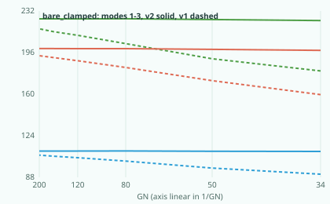
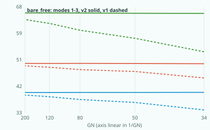
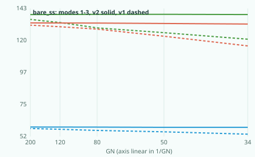
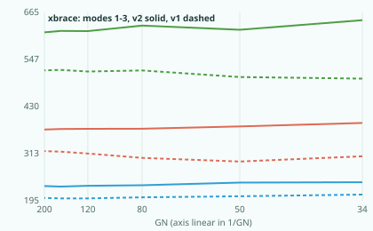
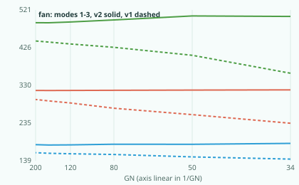
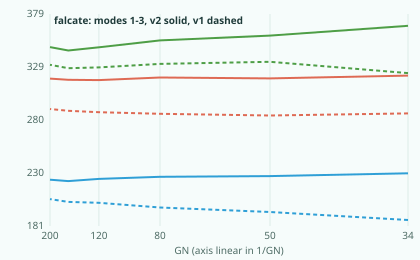
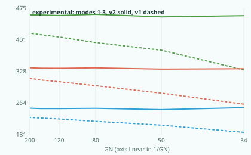
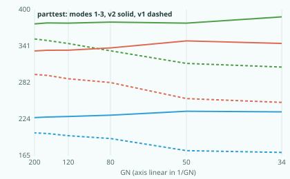
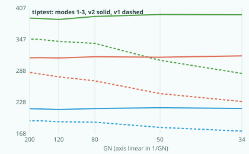
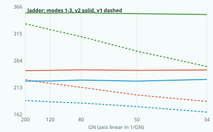

# Solver validation

Commit validated: `6a76fcf` (branch `experimental`). Generated by `tests/make_report.py` from
`tests/out/results.json`; rerun `python tests/validation.py --stages 1,2,3,4,5,6,7,8,9` then this script.

**39 of 56 checks pass.**

## Stage 1: Closed-form plate checks

| Check | Measured | Limit | Result |
|---|---|---|---|
| ss rectangle thin plate | max |err| 0.14% | 0.3% | pass |
| ss rectangle 2.8mm Mindlin | max |err| 0.22% | 0.3% | pass |
| ss rectangle 10mm Mindlin | max |err| 0.53% | 1.5% | pass |
| ss rectangle static patch load | max |err| 0.40% (GN 34, 80) | 1% | pass |

## Stage 2: Exact solutions for the edge fixes

| Check | Measured | Limit | Result |
|---|---|---|---|
| clamped circle vs Leissa | GN34 f1 -0.66%, GN50+ max 0.85% | f1 1% at GN 34, all 1% at GN>=50 | pass |
| clamped square vs Leissa | max |err| 0.90% (GN 50, 80) | 1% | pass |
| rotated square vs unrotated (staircase) | max |diff| 0.94% | 1% | pass |
| free circle vs Leissa | max |err| 0.29%, modes under 5 Hz [3, 3] | 1.5% at GN>=80, exactly 3 rigid | pass |
| simply supported circle vs Leissa | |err| 0.13% | 1% at GN>=50 | pass |
| clamped circle static uniform pressure | max |err| 0.58% | 1.5% at GN>=50 | pass |
| annular plate (free hole) vs Morley FE | max |err| 0.55% | 2% at GN>=80 | pass |

## Stage 3: Convergence on real designs

| Check | Measured | Limit | Result |
|---|---|---|---|
| bare_clamped: GN 80->200 change, modes < 400 Hz | max 0.11% | 2% | pass |
| bare_free: GN 80->200 change, modes < 400 Hz | max 0.31% | 2% | pass |
| bare_ss: GN 80->200 change, modes < 400 Hz | max 0.35% | 2% | pass |
| xbrace: convergence (modes 1-3) | GCI 2.91%, extrapolation gap 1.91%, reversals 4, deflection 50->200 8.0% | GCI<2%, gap<1.5%, <=1 reversal, defl<3% | **fail** |
| fan: convergence (modes 1-3) | GCI 2.26%, extrapolation gap 0.91%, reversals 3, deflection 50->200 1.3% | GCI<2%, gap<1.5%, <=1 reversal, defl<3% | **fail** |
| falcate: convergence (modes 1-3) | GCI 4.60%, extrapolation gap 2.23%, reversals 3, deflection 50->200 4.2% | GCI<2%, gap<1.5%, <=1 reversal, defl<3% | **fail** |
| experimental: convergence (modes 1-3) | GCI 1.84%, extrapolation gap 0.33%, reversals 3, deflection 50->200 1.9% | GCI<2%, gap<1.5%, <=1 reversal, defl<3% | **fail** |
| parttest: convergence (modes 1-3) | GCI 2.62%, extrapolation gap 1.52%, reversals 4, deflection 50->200 6.1% | GCI<2%, gap<1.5%, <=1 reversal, defl<3% | **fail** |
| tiptest: convergence (modes 1-3) | GCI 1.40%, extrapolation gap 0.94%, reversals 4, deflection 50->200 2.4% | GCI<2%, gap<1.5%, <=1 reversal, defl<3% | **fail** |
| ladder: convergence (modes 1-3) | GCI 0.70%, extrapolation gap 0.64%, reversals 4, deflection 50->200 0.5% | GCI<2%, gap<1.5%, <=1 reversal, defl<3% | **fail** |

## Stage 4: Invariance and smoothness

| Check | Measured | Limit | Result |
|---|---|---|---|
| grid alignment shift (Tiptest, GN 80) | max 1.86% | 0.5% | **fail** |
| brace sweep in 0.1-cell steps (GN 34) | max step 1.12%, max 2nd difference 1.907% | 0.3% per step | **fail** |
| brace sweep in 0.1-cell steps (GN 80) | max step 0.46%, max 2nd difference 0.578% | 0.3% per step | **fail** |
| brace rotation 0-90 deg on an isotropic square | max 2nd difference 1.59%, 0/90 symmetry 0.00% | smooth, no jumps at grid-aligned angles | **fail** |
| mirror symmetry (2partTest mirrored) | max 0.30% | 0.1% | **fail** |
| curved brace with control point on the chord = straight | 0.000% | 0.1% | pass |
| equal tip and centre dimensions = untapered | 0.00e+00% | exact | pass |

## Stage 5: Limits and consistency

| Check | Measured | Limit | Result |
|---|---|---|---|
| G_LT, G_RT x1000 -> thin plate (Tiptest braces, no bridge) | 0.042% | 0.1% | pass |
| brace height 0.1 mm -> bare plate (footprint off) | 0.42% | 0.5% | pass |
| brace height 0.001 mm -> bare plate (footprint on) | 0.02% | 0.5% | pass |
| solverVersion 'v1' reproduces the pre-change engine | max rel diff 3.2e-07 | 1e-6 (ARPACK stopping on close pairs) | pass |
| flange cap leaves an isolated brace unchanged | 0.000% | 0.1% | pass |
| parallel braces 100->10 mm: smooth, cap bites only below 2*40h/2 | cap active at gaps [100, 80, 60, 50, 40, 30, 25, 20, 15, 10] mm, max 2nd diff 5.33% | cap only below 112 mm | pass |
| mass bookkeeping (braces + bridge + point masses) | 78.57 g vs 78.57 g | 0.1% | pass |
| point mass 0.5 g vs first-order prediction | max deviation 3.3% | 10% | pass |
| doubling the load doubles the deflection | ratio 2.000000 | 2 exactly | pass |

## Stage 6: Independent 3D solid model (rectangle ladder)

| Check | Measured | Limit | Result |
|---|---|---|---|
| 3D solid rectangle, bare | max |err| 0.9% (mode 1 -0.4%) | 2% bare / 5% braced | pass |
| 3D solid rectangle, brace_x | max |err| 2.8% (mode 1 -2.5%) | 2% bare / 5% braced | pass |
| 3D solid rectangle, brace_y | max |err| 2.1% (mode 1 -2.1%) | 2% bare / 5% braced | pass |
| 3D solid rectangle, bridge | max |err| 3.8% (mode 1 -2.9%) | 2% bare / 5% braced | pass |
| 3D solid rectangle, parallel25 | max |err| 5.0% (mode 1 -2.0%) | 2% bare / 5% braced | pass |
| 3D solid rectangle, cross | max |err| 4.3% (mode 1 -4.3%) | 2% bare / 5% braced | pass |
| 3D solid rectangle, brace_bridge | max |err| 4.6% (mode 1 +0.0%) | 2% bare / 5% braced | pass |

Per-mode error against the 3D solid (tool vs solid, %), v2 then v1:

| Case | v2 modes 1-6 | v1 modes 1-6 |
|---|---|---|
| bare | -0.4 -0.6 -0.4 -0.6 -0.9 -0.5 | -5.8 -7.3 -4.5 -5.7 -7.7 -4.2 |
| brace_x | -2.5 +2.2 +0.1 +0.9 +0.9 +2.8 | -14.7 -8.1 -12.3 -10.3 -7.1 -5.0 |
| brace_y | -2.1 +1.1 +1.3 +0.2 +1.3 +0.2 | -17.6 -5.2 -14.9 -6.9 -7.6 -8.1 |
| bridge | -2.9 +3.8 +1.9 +2.8 +0.2 +2.3 | -9.1 -1.0 -3.2 -1.1 -3.8 -1.5 |
| parallel25 | -2.0 +2.5 +3.3 +1.3 +1.3 +5.0 | -14.7 -10.4 -11.3 -10.7 -9.4 -11.8 |
| cross | -4.3 +1.7 -0.5 -0.1 +0.8 +1.4 | -19.2 -15.7 -14.7 -8.8 -9.8 -13.4 |
| brace_bridge | +0.0 +4.6 +1.2 +2.9 -0.5 -2.6 | -10.7 -2.3 -5.7 -1.8 -13.0 -8.8 |

## Stage 7: Existing ANSYS guitar runs

| Check | Measured | Limit | Result |
|---|---|---|---|
| tiptest vs existing ANSYS run (v2, GN 120, modes 1-3 by order) | +14.9%, +9.6%, +10.6% | 5%, no systematic sign | **fail** |
| tiptest vs existing ANSYS run (v1, GN 120, modes 1-3 by order) | +2.5%, -3.0%, -1.4% | 5%, no systematic sign | pass |
| parttest vs existing ANSYS run (v2, GN 120, modes 1-3 by order) | +28.7%, +7.5%, +5.8% | 5%, no systematic sign | **fail** |
| parttest vs existing ANSYS run (v1, GN 120, modes 1-3 by order) | +11.3%, -7.2%, -3.3% | 5%, no systematic sign | **fail** |
| experimental vs existing ANSYS run (v2, GN 120, modes 1-3 by order) | +9.0%, +10.6%, +27.8% | 5%, no systematic sign | **fail** |
| experimental vs existing ANSYS run (v1, GN 120, modes 1-3 by order) | -1.8%, +0.3%, +13.8% | 5%, no systematic sign | **fail** |

| Design | ANSYS (Hz) | v2 GN 120 (Hz) | v1 GN 120 (Hz) |
|---|---|---|---|
| tiptest | 187, 285, 349, 407, 560 | 214, 313, 386, 416, 521 | 191, 277, 344, 363, 470 |
| parttest | 177, 311, 357, 488, 509 | 228, 334, 378, 487, 525 | 197, 289, 345, 451, 470 |
| experimental | 222, 304, 359, 467, 511 | 242, 336, 458, 532, 552 | 218, 304, 408, 482, 510 |

Predicted bare dreadnought top (clamped, no bridge, plate shear 0.6/0.04 GPa, GN 160): 110.5, 199.4, 225.2, 308.6, 324.5, 347.3 Hz.

Predicted bare dreadnought top (ss, no bridge, plate shear 0.6/0.04 GPa, GN 160): 58.8, 132.5, 138.4, 219.9, 239.2, 264.3 Hz.

## Stage 8: Optimizer behaviour

| Check | Measured | Limit | Result |
|---|---|---|---|
| same seed gives the same design (falcate) | identical | identical | pass |
| falcate on reachable targets (+-2.5%), 5 seeds: card within tolerance | 4/5 | >= 4/5 | pass |

## Stage 9: Performance, parity, compatibility, robustness

| Check | Measured | Limit | Result |
|---|---|---|---|
| GN 34 evaluation time (Tiptest) | 53 ms vs baseline 92 ms | no slower | pass |
| browser and desktop run the same engine file | index.html loads desktop/engine.py | single source | pass |
| old saved projects load and solve | 4/4 | all | pass |
| 200 random layouts at GN 34 | 0 failures, 0 modes under 5 Hz | 0, 0 | pass |

## Known remaining error

- **Brace-to-grid coupling.** A brace is a line beam reading a bilinear plate field, so the frequency ripples by about 1% per 0.1-cell move on the GN 34 search grid (0.4% at GN 80), and a braced top moves up to 1.9% when the grid is shifted under it. Bare tops move under 0.5%. This is handoff diagnosis item 3; the conforming finite element solve (P3) is what removes it.
- **Brace fundamental.** Against the 3D solid, single and crossing braces still read 2-4% low on mode 1 with the 40-thickness flange; modes 2-6 are within about 3%.
- **Existing ANSYS runs.** v2 reads well above the existing guitar ANSYS runs, by more than the 3D solid says it should. Stage 7 explains what to check in ANSYS (bare-plate run, fixed-support scope, contact formulation).
